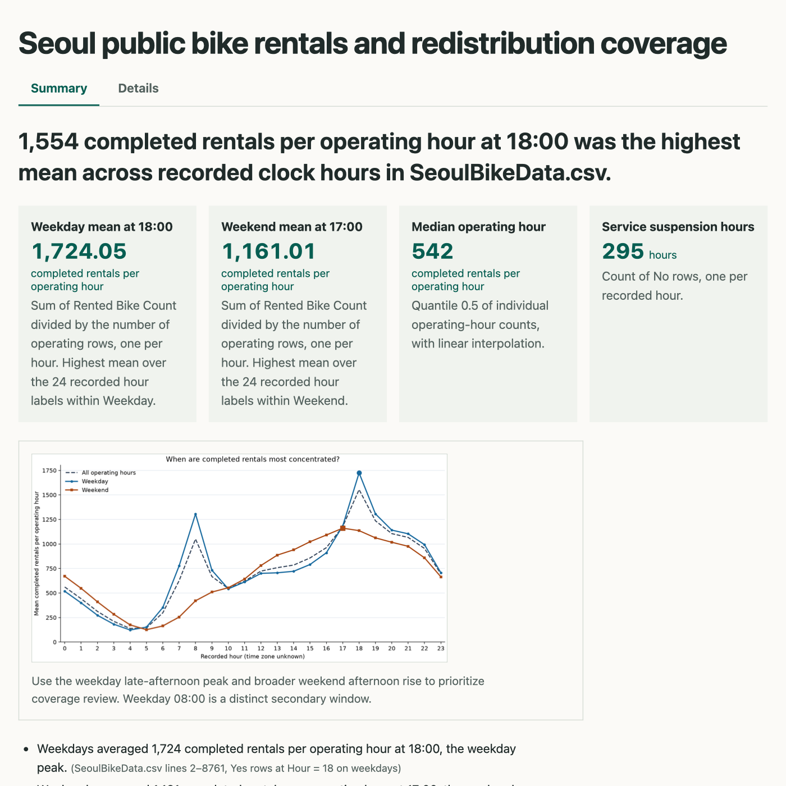

# Ask First EDA

Ask First EDA는 지표의 계산 기준에 따라 결과가 달라지면 어떤 기준을 쓸지 먼저 묻습니다. 확인한 기준으로 지표를 계산하고 차트가 담긴 리포트를 만듭니다.

[English](README.md)

## 작동 방식


<details>
<summary>데이터를 검토하고 지표를 계산하는 방법</summary>

스킬은 Python으로 파일을 살핍니다. 사용자의 질문과 파일 내용을 토대로 지표마다 어느 행을 계산에 넣을지 판단합니다.

두 기준에서 값이 달라지면 스킬은 Python으로 두 값을 계산합니다. 두 값을 보여 주고 어느 기준을 쓸지 묻습니다. 사용자의 언어로 한 번에 하나씩 묻습니다. 사용자가 선택을 미루면 리포트에 각 값과 계산 기준을 함께 표시합니다.

데이터를 정제해야 할 때는 어떤 규칙을 적용할지 먼저 묻습니다. 사용자가 승인한 규칙만 복사본에 적용합니다.

스킬은 HTML 리포트와 JSON 요약 파일을 만듭니다. 결과와 차트는 **요약** 탭에서 보세요. 아래 항목은 **세부** 탭에서 보세요.

- 지표의 계산 기준
- 계산에 쓴 원본 행
- 계산 과정

</details>

[예제 리포트 보기](https://ltljh.github.io/ask-first-eda/gallery/support_tickets.html) · [리포트 갤러리](https://ltljh.github.io/ask-first-eda/gallery/index.html)



## 설치

[최신 릴리스](https://github.com/LTLJH/ask-first-eda/releases/latest)에서 ZIP 파일을 내려받으세요. 사용하는 앱에 맞는 절차를 고르세요.

### Codex와 Claude Code

1. `ask-first-eda.zip`의 압축을 풉니다.
2. 아래 표에서 설치할 위치를 골라 스킬 폴더를 복사합니다.
3. 복사한 스킬 폴더에서 터미널을 엽니다.
4. Python 3.10 이상에서 첫 번째 명령으로 필요한 패키지를 설치합니다.
5. 두 번째 명령으로 설치 상태를 확인합니다.

| 앱 | 한 프로젝트에서 사용 | 모든 프로젝트에서 사용 |
| --- | --- | --- |
| Codex | `<project>/.agents/skills/ask-first-eda/` | `~/.agents/skills/ask-first-eda/` |
| Claude Code | `<project>/.claude/skills/ask-first-eda/` | `~/.claude/skills/ask-first-eda/` |

Windows에서도 `python` 명령을 사용하세요.

```sh
python -m pip install -r requirements.txt
python -I scripts/check_install.py
```

설치가 끝나면 프로젝트 폴더에서 Codex나 Claude Code를 실행하세요. 스킬은 이곳에 분석 작업 폴더를 만듭니다.

### Claude 데스크톱 앱

1. **Settings → Skills**를 엽니다. 버전에 따라 **Customize → Skills** 또는 **Plugins**에 있습니다.
2. `ask-first-eda.zip`을 업로드합니다.
3. Claude에게 업로드한 스킬의 `scripts/check_install.py`를 실행해 달라고 요청합니다. 앱에서 패키지 설치를 제한할 수 있습니다.

ZIP을 직접 만들려면 저장소 최상위 폴더에서 `python scripts/package_skill.py`를 실행하세요. 업로드할 파일은 `dist/ask-first-eda.zip`입니다.

로컬 스킬을 업데이트하려면 스킬 폴더를 교체하세요. 로컬 스킬을 삭제하려면 그 폴더를 지우세요.

데스크톱 앱에서 스킬을 업데이트하려면 새 ZIP을 업로드하세요. 스킬을 삭제하려면 앱 메뉴를 사용하세요.

## 생산 일보로 시작하기

1. [예제 엑셀 파일](examples/messy_production_report/daily_report.xlsx)을 프로젝트 폴더에 복사합니다.
2. `/ask-first-eda`를 실행합니다.
3. “라인별 생산량과 가동률을 봐 줘”라고 요청합니다.

스킬은 엑셀 파일을 살핍니다. 가동률 계산에 어떤 시간을 넣을지와 어떤 정제 규칙을 쓸지 묻습니다.

결과를 보려면 `eda-work/delivery/report.html`을 여세요. 코드에서 결과를 읽으려면 같은 폴더의 `eda_summary.json`을 사용하세요.

## 지원하는 파일

스킬은 아래 형식을 읽습니다.

- CSV와 TSV
- 엑셀(`.xlsx`)
- JSON과 JSONL
- Parquet
- 마크다운 표

스킬은 예전 엑셀 파일(`.xls`) 형식을 감지합니다. 파일 내용을 읽지 못할 수 있습니다.

차트에 한글을 표시하려면 한글을 지원하는 시스템 글꼴이 필요합니다.

스킬은 원본 파일을 그대로 둡니다. 다음 작업은 범위에서 제외합니다.

- 모델을 학습시키거나 튜닝하기
- 자동으로 가설을 검정하거나 p값 계산하기
- 인과관계 판단하기

## 분석 예시

| 데이터 | 리포트와 분석 과정 |
| --- | --- |
| 고객센터 티켓 | [리포트](docs/gallery/support_tickets.html) · [시간 기준에 따른 첫 응답 준수율 차이](docs/walkthroughs/support_tickets.md#sla-clock-comparison) |
| 생산 일보 | [리포트](docs/gallery/messy_production_report.html) · [정제 과정에서 제외한 행](docs/walkthroughs/messy_production_report.md#cleaning) |
| 설비 센서 | [리포트](docs/gallery/equipment_sensors.html) · [분석 과정](docs/walkthroughs/equipment_sensors.md) |
| 배치별 스팀 사용량 | [리포트](docs/gallery/factory_utility.html) · [분석 과정](docs/walkthroughs/factory_utility.md) |
| 서울 따릉이 | [리포트](docs/gallery/seoul_bike.html) · [분석 과정](docs/walkthroughs/seoul_bike.md) |

## 평가 결과

Ask First EDA는 한 줄 지침보다 토큰을 더 썼습니다. 대신 주 스트레스 평가에서 더 높은 점수를 받았습니다(90.74 대 51.16). 6개 사례 모두에서 같거나 앞섰습니다. 이 결과는 사전 등록한 판정 기준을 충족합니다. 분석 토큰 수 중앙값은 3.29배였습니다.

| 평가 항목 | 상대 경로 안내를 포함한 한 줄 지침 | Ask First EDA |
| --- | ---: | ---: |
| 주 평가 점수 | 51.16 | 90.74 |
| 정답인 최종값 | 22/48 | 42/48 |
| 분석 모델이 물은 필수 질문 | 3/24 | 22/24 |
| 성능이 낮은 모델의 점수 | 25.93 | 26.23 |

성능이 낮은 모델에서는 두 조건의 점수가 거의 같았습니다. 정답인 최종값과 분석 모델이 물은 필수 질문의 개수는 두 조건에서 같았습니다.

스킬을 고치기 전에는 별도 시험에서 분석 모델이 첫 턴에 질문한 경우가 0/8이었습니다. 수정 후에는 질문이 필요한 경우 6/6, 필요 없는 경우 0/2에서 질문했습니다.

평가자는 결과를 본 뒤 수치 검사기를 새로 만들어 다시 채점했습니다. 검사기 판정은 표본으로 뽑은 수치 항목 16/16개에서 독립 검토 결과와 일치했습니다.

스킬 작성자가 스킬에 명시한 동작을 시험할 합성 사례를 설계했습니다. 평가에는 모의 사용자를 썼습니다.

[스트레스 평가 결과](evals/stress_summary.md)

### 이전 평가

같은 분석 모델로 합성 사례 6개를 조건별로 두 번씩 시험했습니다. 독립 검토로 36회 실행 결과를 채점했습니다.

| 평가 항목 | 스킬 없이 실행 | 한 줄 지침 | Ask First EDA |
| --- | ---: | ---: | ---: |
| 계산값이 맞은 결과 | 18/24 | 24/24 | 24/24 |
| 계산 기준까지 확인해 최종값으로 제시한 결과 | 14/24 | 18/24 | 18/24 |
| 근거 없이 계산 기준을 단정한 실행 | 6/12 | 2/12 | 0/12 |

한 사례에서는 어떤 기록을 계산에 포함할지 사용자에게 물어야 했습니다. 세 조건 모두 두 번의 실행에서 이 질문을 놓쳤습니다. 한 줄 지침과 스킬은 각각 가능한 기준별로 값을 제시했습니다.

스킬을 썼을 때 분석 시간은 한 줄 지침의 1.76배였습니다. 토큰은 2.00배 썼습니다. 두 수치는 분석 실행당 중앙값을 비교한 값입니다.

[전체 평가 결과, 리포트 확인 및 채점 보정](evals/abc_summary.md) · [이전 평가](evals/ab_summary.md)

### 설치 확인 결과

| 앱 | 확인한 버전 | 2026년 11월 26일 결과 |
| --- | --- | --- |
| Claude Code | 2.1.332 | 요청에 맞는 스킬을 고르는 테스트 4개를 통과했습니다. 새 프로젝트에서 HTML 리포트와 JSON 요약 파일을 생성했습니다. |
| Codex | 0.171.0 | 같은 테스트 4개를 통과했습니다. 평가에는 `codex exec`를 사용했습니다. |
| Claude 데스크톱 앱 | 버전 기록 없음 | 직접 ZIP을 업로드해 실행을 확인했습니다. |

[설치 테스트 결과](evals/install_smoke.json) · [시스템 구조](docs/architecture.md)

## 라이선스

코드는 [MIT 라이선스](LICENSE)를 따릅니다. [예제 데이터](examples/README.md)는 각각의 라이선스를 따릅니다.

[기여 안내](CONTRIBUTING.md)
