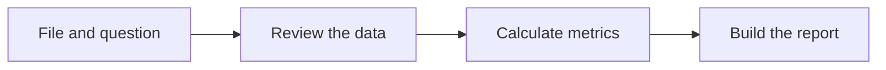
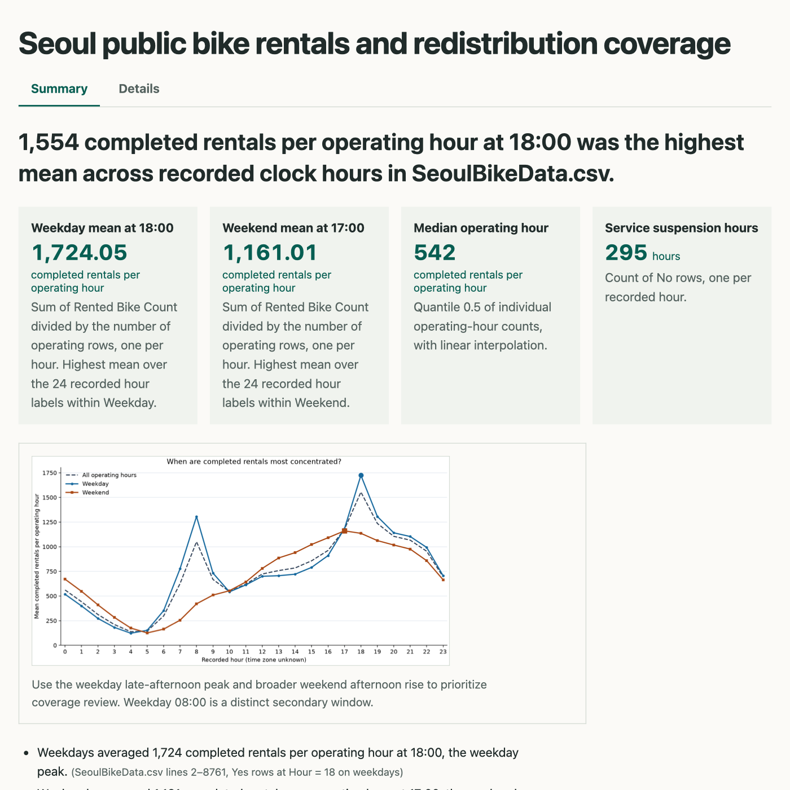

# Ask First EDA

When a metric’s definition affects the result, Ask First EDA asks which definition to use. The skill calculates the metric with your answer and creates a report with charts.

[Korean](README.ko.md)

## How it works



<details>
<summary>How the assistant reviews the data and calculates metrics</summary>

The skill uses Python to inspect the file. The skill uses your question and the file to identify which records count toward each metric.

If two definitions give different values, the skill uses Python to calculate both. The skill shows both values and asks which definition to use. It asks one question at a time in your language. If you defer the choice, the report shows each value with its definition.

If the data needs cleaning, the skill asks which rules to apply. It applies the rules you approve to a copy of the data.

The skill creates an HTML report and a JSON summary. Open the **Summary** tab for results and charts. Open the **Details** tab for these items.

- Metric definitions
- Source rows
- Calculations

</details>

[View an example report](https://ltljh.github.io/ask-first-eda/gallery/support_tickets.html) · [Browse the gallery](https://ltljh.github.io/ask-first-eda/gallery/index.html)



## Install

[Download the latest release](https://github.com/LTLJH/ask-first-eda/releases/latest). Choose the instructions for your app.

### Codex or Claude Code

1. Extract `ask-first-eda.zip`.
2. Copy the extracted skill folder to one of the paths below.
3. Open a terminal in the installed skill folder.
4. Install the dependencies with Python 3.10 or later.
5. Run the installation check.

| App | For one project | For all projects |
| --- | --- | --- |
| Codex | `<project>/.agents/skills/ask-first-eda/` | `~/.agents/skills/ask-first-eda/` |
| Claude Code | `<project>/.claude/skills/ask-first-eda/` | `~/.claude/skills/ask-first-eda/` |

Use these commands for steps 4 and 5. On Windows, use the `python` command.

```sh
python -m pip install -r requirements.txt
python -I scripts/check_install.py
```

Start Codex or Claude Code from your project folder. The skill creates its work folder there.

### Claude desktop app

1. Open **Settings → Skills**. Some versions list skills under **Customize → Skills** or **Plugins**.
2. Upload `ask-first-eda.zip`.
3. Ask Claude to run `scripts/check_install.py` from the uploaded skill. The app may block attempts to install packages.

To build the ZIP from source, run `python scripts/package_skill.py` from the repository root. Upload `dist/ask-first-eda.zip`.

To update the local skill, replace its folder. To uninstall the local skill, remove its folder.

In the desktop app, upload the new ZIP to update the skill. Use the app menu to remove the skill.

## Try the production report example

1. Copy [the example workbook](examples/messy_production_report/daily_report.xlsx) into your project.
2. Start `/ask-first-eda`.
3. Ask “Show production and utilization by line.”

The skill inspects the workbook. It asks which hours count toward utilization and which cleaning rules to apply.

Open `eda-work/delivery/report.html` to read the results. Use `eda_summary.json` in the same folder to read the results in code.

## Supported files

The skill reads these formats.

- CSV and TSV
- Excel (`.xlsx`)
- JSON and JSONL
- Parquet
- Markdown tables

The skill detects older Excel files (`.xls`). It may fail to read them.

Korean chart labels require a system font that supports Hangul.

The skill preserves the source file. Its scope excludes these tasks.

- Train or tune models.
- Run automatic hypothesis tests or calculate p-values.
- Make claims about causation.

## Examples

| Example | Report and analysis |
| --- | --- |
| Support tickets | [Report](docs/gallery/support_tickets.html) · [How the choice of clock affects first-response compliance](docs/walkthroughs/support_tickets.md#sla-clock-comparison) |
| Production records | [Report](docs/gallery/messy_production_report.html) · [Which rows the cleaning rules exclude](docs/walkthroughs/messy_production_report.md#cleaning) |
| Equipment sensors | [Report](docs/gallery/equipment_sensors.html) · [Analysis](docs/walkthroughs/equipment_sensors.md) |
| Factory utility use | [Report](docs/gallery/factory_utility.html) · [Analysis](docs/walkthroughs/factory_utility.md) |
| Seoul Bike | [Report](docs/gallery/seoul_bike.html) · [Analysis](docs/walkthroughs/seoul_bike.md) |

## Evaluation

Ask First EDA used more tokens than a one-line instruction. It also scored higher in the main stress evaluation, 90.74 against 51.16. It tied or led in 6/6 cases. This result met the preregistered decision rule. The median analyst token count was 3.29 times higher.

| Measure | One-line instruction with relative-path guidance | Ask First EDA |
| --- | ---: | ---: |
| Main score | 51.16 | 90.74 |
| Correct final values | 22/48 | 42/48 |
| Required questions the analyst asked | 3/24 | 22/24 |
| Weaker-model score | 25.93 | 26.23 |

With the weaker model, the scores were nearly equal. Both conditions yielded the same counts of correct final values and required questions the analyst asked.

Before the skill changed, the analyst asked a first-turn question in 0/8 probe runs. With the updated skill, the analyst asked in 6/6 runs that required a question and 0/2 runs that required none.

The evaluator wrote a new numeric checker after seeing the results and used it to rescore them. The checker agreed with an independent review on 16/16 sampled slots.

The skill’s author designed synthetic cases to test behaviors the skill specifies. The evaluation used a simulated user.

[Stress evaluation results](evals/stress_summary.md)

### Earlier evaluation

The same analyst model ran six synthetic cases twice under each condition. An independent review scored the 36 runs.

| Measure | No skill | One-line instruction | Ask First EDA |
| --- | ---: | ---: | ---: |
| Correct numeric results | 18/24 | 24/24 | 24/24 |
| Final values with an established definition | 14/24 | 18/24 | 18/24 |
| Runs where the analyst assumed a definition without evidence | 6/12 | 2/12 | 0/12 |

In one case, the analyst needed to ask which records to count. No condition asked that question in either run. The one-line instruction and the skill both produced values for each possible definition.

The skill took 1.76 times as long as the one-line instruction. The skill used 2.00 times as many tokens. Both ratios compare medians per analyst run.

[Full results, including delivery checks and grading corrections](evals/abc_summary.md) · [Earlier evaluation](evals/ab_summary.md)

### Installation checks

| App | Version tested | Result on November 26, 2026 |
| --- | --- | --- |
| Claude Code | 2.1.332 | Passed four routing checks. Created the HTML report and JSON summary in a clean project. |
| Codex | 0.171.0 | Passed four routing checks. Evaluation runs used `codex exec`. |
| Claude desktop app | Version unrecorded | Passed a manual upload and run. |

[Installation test results](evals/install_smoke.json) · [System architecture](docs/architecture.md)

## License

The [MIT license](LICENSE) applies to the code. The [example datasets](examples/README.md) retain their own licenses.

[Contribution guide](CONTRIBUTING.md)
