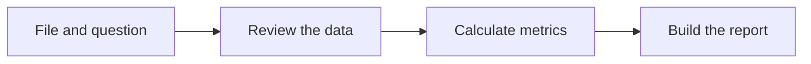

# Ask First EDA

Ask First EDA uses your data file to answer your question in a report with charts.

[Korean](README.ko.md)

## How it works



<details>
<summary>How the assistant reviews the data and calculates metrics</summary>

Python inspects the file. The assistant uses your question and the file to identify which records count toward each metric.

If two definitions give different values, the assistant uses Python to calculate both. It shows both values and asks which definition to use. It asks one question at a time in your language. If you defer the choice, the report shows each value with its definition.

If the data needs cleaning, the assistant asks which rules to apply. It applies the rules you approve to a copy of the data.

The skill creates an HTML report and a JSON summary. Open the **Summary** tab for the results and charts. Open the **Details** tab for the definitions, source rows, and calculations.

</details>

[View an example report](https://ltljh.github.io/ask-first-eda/gallery/support_tickets.html) · [Browse the gallery](https://ltljh.github.io/ask-first-eda/gallery/index.html)


## Install

[Download the latest release](https://github.com/LTLJH/ask-first-eda/releases/latest). Choose the instructions for your app.

### Codex or Claude Code

1. Extract `ask-first-eda.zip`.
2. Copy the extracted skill folder to one of the paths below.
3. Open a terminal in the installed skill folder.
4. Install the dependencies with Python 3.10 or later.
5. Run the installation check.

| App | For one project | For all projects |
| --- | --- | --- |
| Codex | `<project>/.agents/skills/ask-first-eda/` | `~/.agents/skills/ask-first-eda/` |
| Claude Code | `<project>/.claude/skills/ask-first-eda/` | `~/.claude/skills/ask-first-eda/` |

Use these commands for steps 4 and 5. On Windows, use the `python` command.

```sh
python -m pip install -r requirements.txt
python -I scripts/check_install.py
```

Start Codex or Claude Code from your project folder. The skill creates its work folder there.

### Claude desktop app

1. Open **Settings → Skills**. Some versions list skills under **Customize → Skills** or **Plugins**.
2. Upload `ask-first-eda.zip`.
3. Ask Claude to run `scripts/check_install.py` from the uploaded skill. The app may block package installation.

To build the ZIP from source, run `python scripts/package_skill.py` from the repository root. Upload `dist/ask-first-eda.zip`.

To update a local installation, replace the installed folder. To uninstall the skill, remove that folder. In the desktop app, upload the new ZIP to update the skill or remove the skill through the app.

## Try the production report example

1. Copy [the example workbook](examples/messy_production_report/daily_report.xlsx) into your project.
2. Start `/ask-first-eda`.
3. Ask “Show production and utilization by line.”

The assistant inspects the workbook. It asks which hours count toward utilization and which cleaning rules to apply. Open `eda-work/delivery/report.html` to read the results. Use `eda_summary.json` in the same folder to read the results in code.

## Supported files

The skill reads CSV, TSV, Excel (`.xlsx`), JSON, JSONL, Parquet, and Markdown tables. It detects older Excel files (`.xls`). The skill does not guarantee that it can read them. Korean chart labels require a system font that supports Hangul.

The skill preserves the source file. Its scope excludes model training, model tuning, automatic hypothesis tests, p-values, and claims about causation.

## Examples

| Example | Report and analysis |
| --- | --- |
| Support tickets | [Report](docs/gallery/support_tickets.html) · [How the choice of clock affects first-response compliance](docs/walkthroughs/support_tickets.md#sla-clock-comparison) |
| Production records | [Report](docs/gallery/messy_production_report.html) · [Which rows the cleaning rules exclude](docs/walkthroughs/messy_production_report.md#cleaning) |
| Equipment sensors | [Report](docs/gallery/equipment_sensors.html) · [Analysis](docs/walkthroughs/equipment_sensors.md) |
| Factory utility use | [Report](docs/gallery/factory_utility.html) · [Analysis](docs/walkthroughs/factory_utility.md) |
| Seoul Bike | [Report](docs/gallery/seoul_bike.html) · [Analysis](docs/walkthroughs/seoul_bike.md) |

## Evaluation

An independent review compared 36 runs across six synthetic cases.

| Condition | Correct numeric results |
| --- | ---: |
| A. No skill | 18/24 |
| B. One-line instruction | 24/24 |
| C. Ask First EDA | 24/24 |

In conditions B and C, the evidence supported both the value and its definition for 18 of 24 results in each condition. No condition asked the required question about the denominator. In condition C, the assistant made no unsupported claims about metric definitions and exposed no home directory paths. Condition C used about twice the median analyst time and token count of condition B.

[Evaluation results and grading corrections](evals/abc_summary.md) · [Earlier evaluation](evals/ab_summary.md)

### Installation checks

| App | Version tested | Result on November 26, 2026 |
| --- | --- | --- |
| Claude Code | 2.1.332 | Passed four routing checks. Created the HTML report and JSON summary in a clean project. |
| Codex | 0.171.0 | Passed four routing checks. Evaluation runs used `codex exec`. |
| Claude desktop app | Version unrecorded | Passed a manual upload and run. |

[Installation test results](evals/install_smoke.json) · [System architecture](docs/architecture.md)

## License

The [MIT license](LICENSE) applies to the code. The [example datasets](examples/README.md) retain their own licenses.

[Contribution guide](CONTRIBUTING.md)
